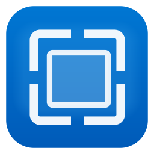

# AlphaSnipe

AlphaSnipe is a cross platform screenshot utility that also supports drag and drop. This prevents temporary files from cluttering your workspace
as you can just drag snipped images into an upload webform that supports drag and drop.
It also supports cli commands, making it possible to automate Screenshot creation in agentic workflows.



## Features

- **Rectangle, freeform, window, and fullscreen** snips
- Rectangle snip: drag a box; releasing the mouse captures it
- Dimmed overlay with size readout and magnifier loupe
- Delay (none / 3 / 5 / 10 seconds)
- Annotation: pen, highlighter, eraser, crop, undo
- Drag-and-drop handle to drop the snip into other apps
- Copy to clipboard and save PNG
- Global shortcut: **Ctrl+Shift+S**
- Runs on **Windows**, **Linux (X11)**, and **macOS**

## Packages

| Platform | Artifact |
| --- | --- |
| Linux x86_64 | `dist/AlphaSnipe-1.0.0-linux-x86_64.tar.gz` and `alphasnipe_1.0.0_amd64.deb` |
| Windows x86_64 | `dist/AlphaSnipe-1.0.0-windows-x86_64.zip` (`AlphaSnipe.exe`) |
| macOS | Build on a Mac or via GitHub Actions: `scripts/package-macos.sh` |

### Linux

```bash
tar xf AlphaSnipe-1.0.0-linux-x86_64.tar.gz
cd AlphaSnipe-1.0.0-linux-x86_64
./alphasnipe
```

Or install the Debian package:

```bash
sudo dpkg -i alphasnipe_1.0.0_amd64.deb
alphasnipe
```

Needs `libx11-6` and `libxext6`.

### Windows

Unzip and run `AlphaSnipe.exe`. No extra runtime is required (statically linked MinGW build).

### macOS

Build on macOS:

```bash
bash scripts/package-macos.sh
```

Grant **Screen Recording** permission when prompted (System Settings → Privacy & Security).

## Shortcuts

| Key | Action |
| --- | --- |
| Ctrl+Shift+S | New snip |
| 1 / 2 / 3 / 4 | Rectangle / Freeform / Window / Fullscreen (on overlay) |
| Esc | Cancel snip, crop, or drag selection |
| Ctrl+C | Copy |
| Ctrl+S | Save |
| Ctrl+Z | Undo ink |
| P / H / E / D | Pen / Highlighter / Eraser / Drag-and-drop |
| Mouse wheel | Zoom in the editor |
| Space + drag | Pan |

## Command line

```
alphasnipe [options]
  --new                 Start a snip immediately
  --mode MODE           rect | freeform | window | full
  --delay N             Delay N seconds
  --demo                Use a generated demo desktop
  --output FILE         Fullscreen capture to PNG, then exit
  --region x,y,w,h      Crop that rectangle (with --output)
  --self-test           Run unit tests
```

## Build from source

### Linux

```bash
sudo apt install cmake g++ libx11-dev libxext-dev
cmake -S . -B build -DCMAKE_BUILD_TYPE=Release
cmake --build build -j
./build/alphasnipe --self-test
./build/alphasnipe --demo
```

### Windows (native)

Open the tree in Visual Studio, or:

```bat
cmake -S . -B build -DCMAKE_BUILD_TYPE=Release
cmake --build build --config Release
```

### Windows (cross-compile from Linux)

```bash
sudo apt install g++-mingw-w64-x86-64
bash scripts/package.sh --windows-only
```

### macOS

```bash
brew install cmake
bash scripts/package-macos.sh
```

`scripts/package.sh` produces Linux and Windows archives from a Linux host. GitHub Actions (`.github/workflows/build.yml`) builds all three platforms.

## How capture works

- **Windows:** GDI `BitBlt` of the virtual screen (`SRCCOPY | CAPTUREBLT`)
- **Linux:** X11 `XCopyArea` / `XGetImage`, then compositing mapped top-level windows if the root is empty (common on compositors)
- **macOS:** `CGWindowListCreateImage`

The overlay always works from a frozen screenshot, so the snip UI is never included in the image.

## License

MIT. DejaVu Sans is bundled under its own license (`assets/DejaVuSans.LICENSE.txt`). `stb_image_write` and `stb_truetype` are public domain / MIT.
